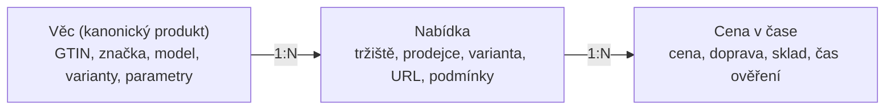

# Data a indexace: jaké jsou v roce 2026 možnosti

## Shrnutí

Legální cesta „stáhnout si celé Allegro a AliExpress“ neexistuje. Nejlepší
kombinace pro rok 2026:

1. **Oficiální API a affiliate programy** jako páteř (přesné a legální).
2. **Vlastní katalog věcí** (kanonické produkty s GTIN/EAN) jako „mozek“,
   na který se nabídky z tržišť párují.
3. **Dotaz v reálném čase s mezipamětí** (fan-out do API při hledání plus
   pravidelné obnovování oblíbených a hlídaných věcí), takže je vše „po ruce“.
4. **Později obohacení od uživatelů** přes rozšíření prohlížeče, výhradně se
   souhlasem a bez cookies či osobních dat.

Hromadný serverový scraping jako základ nedoporučuji (právní a provozní riziko,
viz níže).

## Zdroje podle tržiště

| Tržiště | Oficiální přístup | Co dostaneme | Omezení | Pro nás |
|---|---|---|---|---|
| **AliExpress** | Open Platform: Affiliate API (vyhledání, detail, populární produkty, generování affiliate odkazů); parametry cílové země, měny a jazyka | Ceny pro cílovou zemi a měnu, obrázky, hodnocení, affiliate odkaz | Schválení affiliate účtu, limity volání; cena se může lišit od ceny konkrétního uživatele (kupóny, nabídky pro nové zákazníky) | **Hlavní zdroj fáze 1** |
| **AliExpress** | Dropshipping API (mj. vytvoření objednávky) | Objednávky za dropshippera | Byli bychom kupující a prodejce v jednom (reklamace, záruky, DPH) | Nedoporučuji pro MVP |
| **Allegro** | REST API, `GET /offers/listing` | Vyhledávání nabídek, filtry, ceny | **Jen pro ověřené aplikace (od 1. 6. 2021)**, žádost přes formulář; popularita jen v rozmezích 0, 1–5, 6–10, 11–20, 21–50, 51–100, 101+ | Hned podat žádost o verifikaci |
| **Allegro** | Affiliate | Provize z nákupů | Program Allegro.cz je v jedné z affiliate sítí veden jako pozastavený; v Polsku běží „Allegro Polecam“ | Jednat přímo s Allegrem |
| **Aukro** | Veřejné API pro vyhledávání jsme nenašli (existují integrace pro prodejce, např. přes Base) | — | — | Fáze 2, jednání o datovém feedu |

## Možnosti indexace porovnané

| Varianta | Výhody | Nevýhody | Verdikt |
|---|---|---|---|
| **A. API v reálném čase** | Přesné, aktuální, legální | Limity volání, latence, závislost na schválení | Páteř |
| **B. Affiliate produktové feedy** | Levný přehled sortimentu pro našeptávač a katalog | Zpoždění, neúplnost | Doplněk |
| **C. Vlastní katalog věcí** (Open Icecat, GS1/GTIN, výrobci, Wikidata) | Parametry, fotky, manuály, kategorie | Neobsahuje ceny; Open Icecat vyžaduje uvést „Specs Icecat“ s odkazem | Základ karty věci |
| **D. Obohacení od uživatelů** (rozšíření přečte cenu a dopravu na stránce, kterou si uživatel sám otevřel) | „Cena pro tebe“, ověření ceny v reálu | Nutný souhlas, právní posouzení podmínek tržišť, nesmí přenášet cookies ani osobní data | Fáze 2 |
| **E. Hromadný scraping serverem** | Technicky možný | Porušení podmínek, databázové právo pořizovatele (směrnice 96/9/ES; SDEU *Innoweb* C‑202/12 k meta-vyhledávačům, *CV‑Online* C‑762/19), anti-bot ochrany | **Ne jako základ** |
| **F. Partnerství / výměna dat** | Nejlepší dlouhodobě | Vyjednávání trvá | Paralelně od začátku |

## Datový model: tři vrstvy

- **Věc** je to, co uživatel hledá („Aurion Buds 3 Pro, černá“).
- **Nabídka** je konkrétní prodej na konkrétním tržišti.
- **Cena v čase** dává historii ceny, nejnižší cenu za 30 dní a detekci
  falešných slev.

## Párování nabídek na věc

1. **Přesná shoda:** GTIN/EAN, nebo značka + kód výrobce (MPN) po normalizaci
   (`WH1000XM5` = `WH-1000XM5`).
2. **Strukturovaná extrakce z titulku a parametrů** (jazykový model vrátí JSON
   podle schématu: značka, model, varianta, kapacita, barva).
3. **Podobnost textu a obrázku** (vícejazyčné embeddingy textu a obrázků).
4. **Ověření sporných párů** jazykovým modelem s pravidly („128 GB ≠ 256 GB“).
5. **Míra jistoty** se propisuje do UI: při nižší jistotě řádek ukáže
   „Možná jiná varianta“ místo tichého zařazení.
6. Ruční kontrola u top věcí a u nahlášených chyb.

## Čerstvost: jak mít vše „po ruce“

| Úroveň | Co | Obnova |
|---|---|---|
| Horká | Hlídané a nejhledanější věci | každých 15–60 min |
| Teplá | Věci s návštěvou za posledních 7 dní | několikrát denně |
| Studená | Dlouhý ocas | na vyžádání při otevření karty |

Pravidla:
- Karta se otevře okamžitě z mezipaměti a ceny se na pozadí ověří
  (*stale-while-revalidate*); změněná cena se plynule přepíše.
- Těsně před předáním k nákupu se cena ověří znovu. Pokud se změnila,
  uživatel to vidí dřív, než odejde na tržiště.
- Každá cena nese čas ověření a zdroj.

## Právní kontrolní seznam (projít s advokátem před spuštěním)

- Podmínky API a affiliate programů každého tržiště: povolují cashback,
  rozšíření prohlížeče, mobilní aplikace, ukládání a zobrazování dat?
- Databázové právo a autorské právo k fotkám a popisům.
- **GDPR:** minimalizace dat, historie hledání primárně v zařízení.
- **DSA:** jakmile hostujeme recenze, jsme poskytovatel hostingu, případně
  online platforma (oznamování nezákonného obsahu, odůvodnění zásahů,
  zákaz temných vzorců v čl. 25, transparentnost doporučování v čl. 27).
- **Řazení:** spotřebitelé musí znát hlavní parametry řazení a placené
  zvýhodnění musí být označené (směrnice Omnibus, nařízení P2B). Proto má
  seznam nabídek odkaz „Jak řadíme“.
- **Rozšíření Chrome:** od 2025 platí pravidla pro affiliate odkazy:
  affiliate program musí být popsaný v obchodě i v UI a odkaz se smí vložit
  jen po akci uživatele a s jasným přínosem pro něj (vynucováno od
  10. 6. 2025, reakce na kauzu PayPal Honey).
