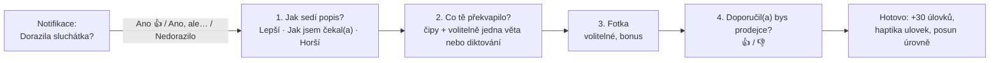

# Recenze a odměny (úlovky)

## Proč lidé recenze nepíšou a co pomáhá

Recenze nevznikají, když je to pracné, ve špatnou chvíli a když člověk nevidí,
že to někomu pomohlo. Páky, které použijeme:

| Páka | Jak |
|---|---|
| **Načasování** | Dva dny po odhadovaném doručení, ne hned po kliknutí na „koupit“ |
| **Námaha** | Recenze za 30 sekund, první odpověď jedním klepnutím přímo v notifikaci |
| **Viditelný dopad** | „Tvoje recenze pomohla 214 lidem“ |
| **Identita a reputace** | Odborné odznaky („Znalec: sluchátka“), hlasy „Užitečné“ |
| **Darovaný pokrok** | Úroveň nezačíná od nuly (Nunes a Drèze 2006: 34 % vs. 19 % dokončení u věrnostní karty s předem darovanými razítky) |
| **Férová odměna** | Úlovky za každou recenzi bez ohledu na hodnocení |

## Recenze za 30 sekund

- **Krok 0 v notifikaci** se počítá jako mikro-recenze doručení, i když člověk
  dál nepokračuje.
- **Čipy** se generují z kategorie a z častých témat ostatních recenzí
  („menší, než jsem čekal“, „skvělý zvuk“, „slabá baterie“, „rychlé doručení“).
- **Diktování a úprava textu:** jazykový model opraví jen překlepy a
  interpunkci, uživatel vidí rozdíl a potvrdí ho. Nikdy nemění smysl.
- **Tři oddělené rozměry:** věc (sdílená napříč tržišti), prodejce
  (konkrétní obchod) a doručení (prodejce + trasa). Špatný kurýr tak
  nepotopí dobrý produkt.

## Ověřený nákup

Štítek „Ověřený nákup“ jen tehdy, když nákup potvrdí:
1. affiliate atribuce (nákup přes náš odkaz),
2. importovaný e-mail s potvrzením objednávky (dobrovolné propojení), nebo
3. účtenka či screenshot objednávky s kontrolou proti podvodům.

Hvězdičky mohou dávat jen ověření kupující. Neověření mohou psát otázky a
komentáře. Způsob ověřování je popsaný přímo u recenzí (vyžaduje to směrnice
Omnibus).

## Gamifikace bez manipulace

- **Úrovně:** Stopař → Lovec → Zkušený lovec → Mistr lovu. Výhody: vyšší
  podíl z cashbacku, dřívější upozornění na pokles ceny.
- **Odborné odznaky** podle kategorie po pěti užitečných recenzích.
- **Měsíční výzvy komunity** (např. recenze s fotkou v kategorii).
- **Série jen týdenní**, se „zmražením“. Žádný tlak strachem ze ztráty.
- **Žebříčky** jen dobrovolné, po kategoriích nebo mezi přáteli.

## Pravidla podle práva (směrnice Omnibus 2019/2161, DSA)

- Úlovky za každou recenzi stejně, ať je pozitivní, nebo negativní.
- Recenze, za kterou byla odměna, má štítek „Recenze s odměnou“.
- Negativní recenze nikdy neschováváme ani nefiltrujeme. Pravidla moderace
  jsou veřejná.
- Uvádíme, jak recenze ověřujeme.
- Nezákonný obsah: oznamovací mechanismus a odůvodnění zásahu (DSA).

## Systém odměn „úlovky“

**Za co se získávají:**
- nákup přes Ulovko (podíl z affiliate provize, u nabídky jen pokud známe sazbu),
- recenze, fotka, hlasy „Užitečné“,
- pozvání přítele (bonus pro oba),
- Cenová jistota (kompenzace rozdílu ceny),
- komunitní výzvy.

**Za co se utrácejí:**
- dárkové poukazy partnerů,
- výběr na účet nad minimální částkou (fáze 2),
- příspěvek na charitu,
- prémiové funkce (víc hlídaných cen, dřívější upozornění).

**Ekonomika a poctivost:**
- Odměny platí affiliate provize. Cíl k rozhodnutí: kolik procent provize
  vracíme uživateli (pracovně 50 %).
- Body z nákupu jsou nejdřív „čekající“ a potvrdí se po lhůtě pro vrácení
  zboží, protože tehdy teprve tržiště potvrdí provizi. UI ukazuje očekávané
  datum potvrzení, aby nebylo zklamání.
- **Před spuštěním ověřit:** zda affiliate podmínky AliExpressu a Allegra
  cashback povolují a jaké jsou regulatorní požadavky na výplatu peněz.
