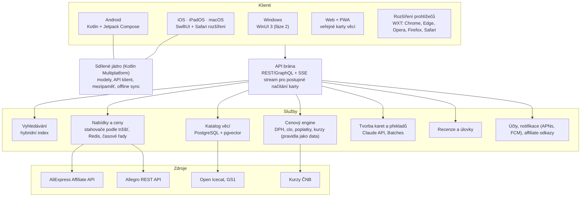

# Architektura a technologie

## Principy

1. **Chytrý server, tenký nativní klient.** Vyhledávání, katalog, cenový
   engine, karty a překlady běží na serveru. Klient vykresluje a ukládá do
   mezipaměti.
2. **Jedna pravda o ceně.** Cenový engine je jeden a dává stejný výsledek
   v aplikaci, na webu i v rozšíření.
3. **Offline jako výchozí stav** pro hlídané ceny, historii a rozepsané recenze.
4. **Soukromí od návrhu:** hosting v EU, minimum osobních dat, historie
   hledání primárně v zařízení.

## Přehled



## Klienti: doporučení a proč

| Platforma | Doporučení | Proč |
|---|---|---|
| iOS, iPadOS, macOS | **SwiftUI** | Liquid Glass zdarma, App Intents, widgety, Live Activities, hostitel Safari rozšíření, jeden kód pro tři platformy |
| Android | **Kotlin + Jetpack Compose** | Material 3 Expressive, nejlepší haptika a gesta |
| Sdílená logika | **Kotlin Multiplatform** | Modely, API klient, mezipaměť a offline režim jednou; UI zůstává nativní |
| Windows | **WinUI 3** (fáze 2), do té doby instalovatelná PWA | Fluent 2, Mica, nativní chování |
| Web | Framework se server-side renderingem (např. Next.js) | Každá karta věci má veřejnou URL: sdílení a návštěvy z Googlu |
| Rozšíření | **WXT** | Jeden kód pro Chrome, Edge, Opera, Firefox i Safari |

**Zvážené alternativy:**
- *React Native / Expo:* jeden tým a rychlejší start, nativní komponenty,
  haptika a gesta přes knihovny. Dobrá volba, pokud bude tým javascriptový.
- *Compose Multiplatform pro iOS* je stabilní od verze 1.8.0 (květen 2025),
  ale na iOS nekreslí systémové komponenty, takže Liquid Glass nedostaneme
  automaticky.
- *Flutter:* vlastní vykreslování, stejný problém s nativním vzhledem.
  Kvůli požadavku „působit všude nativně“ ho nedoporučuji.

## Backend

- **Jazyk:** Kotlin (Ktor), aby modely a cenový engine sdílely kód s KMP
  jádrem v aplikacích. Alternativa TypeScript, pokud tým preferuje.
- **Data:** PostgreSQL (+ pgvector), vyhledávací engine (Typesense nebo
  Meilisearch, později OpenSearch nebo Vespa), Redis (horké ceny, limity),
  objektové úložiště (obrázky, překlady), fronta a workflow pro stahování
  (např. Temporal), analytická databáze (např. ClickHouse).

## AI vrstva

| Úloha | Model a režim |
|---|---|
| Syntéza karty věci, souhrny recenzí | Claude Opus 5.5 (`claude-opus-5-5`), strukturované výstupy, dávkově přes Message Batches API |
| Překlad a přepis nabídek | Claude Opus 5.5 přes Batches, prompt caching pro systémový prompt a slovník kategorie |
| Extrakce parametrů a párování variant | Claude Opus 5.5 se strukturovaným výstupem (JSON schéma) |
| Porozumění dotazu po odeslání | Claude Opus 5.5 s nízkým nastavením effort; levnější model jen po evaluaci (rozhodnutí na tobě) |
| Okamžité a soukromé úlohy v zařízení | Apple Foundation Models, Chrome Translator API, ML Kit |

**Evaluace:** zlatá sada (např. 500 nabídek na kategorii) pro kvalitu překladu
a kontrolu číselných invariantů. Každá změna promptu nebo modelu se změří.

## Výkonnostní rozpočty

| Operace | Cíl (p95) |
|---|---|
| Našeptávač (server) | ≤ 100 ms |
| První výsledky | ≤ 800 ms |
| Karta z mezipaměti, první vykreslení | ≤ 1 s |
| Ověření ceny při otevření karty | ≤ 2 s |

## Bezpečnost

- Žádné přihlašovací údaje k tržištím.
- Rozšíření: jen volitelná oprávnění pro podporovaná tržiště a `activeTab`.
- Analytika šetrná k soukromí, šifrování, pravidelné mazání.

## Struktura repozitáře (stav k 4. 10. 2026)

```
ulovko/
  shared/core/     Kotlin Multiplatform (JVM, iOS, macOS): peníze, kurzy ECB, trhy,
                   pravidla DPH a cel jako data, cenový engine, Nejlepší volba,
                   skóre důvěry, pásma prodaných kusů. 27 testů.
  shared/design/   Vygenerované design tokeny pro Kotlin + test kontrastu WCAG.
  services/api/    Ktor: GET /v1/search, /v1/rules, /health. Klient AliExpress
                   Affiliate API (podpis ověřený proti referenčnímu SDK). 19 testů.
  design/tokens/   tokens.json → generate.mjs → Kotlin, Swift, CSS
  apps/            apple, android, windows, web, extension (README s postupem)
  docs/  prototype/
```

Spuštění a testy:

```
cd ulovko
./gradlew check                                   # všechny testy
node design/tokens/generate.mjs --check           # tokeny jsou aktuální
./gradlew :services:api:run                       # http://localhost:8080
curl "localhost:8080/v1/search?q=sluchátka&market=CZ"
```

Bez proměnných `AE_APP_KEY` a `AE_APP_SECRET` běží API ve vývojovém režimu se
smyšlenými produkty a kurzy; odpověď to přizná (`source: aliexpress-fixture`,
varování `rates.sample_not_real`). Se skutečnými údaji: `AE_APP_KEY`,
`AE_APP_SECRET`, `AE_TRACKING_ID`, kurzy živě z ECB (`ULOVKO_RATES=ecb`) nebo ze
souboru (`ULOVKO_RATES=/cesta/eurofxref-daily.xml`), vlastní pravidla
`ULOVKO_RULES=/cesta/rules.json`.

### Odpověď /v1/search

Každá nabídka nese `price` = rozpad z cenového enginu: celková částka v měně trhu,
`confidence` (`VERIFIED`, `ESTIMATE`, `INCOMPLETE`) a řádky `ITEMS`, `SHIPPING`,
`VAT`, `DUTY`, `HANDLING_FEE` se stavem (`EXACT`, `ESTIMATED`, `INCLUDED`,
`NOT_APPLICABLE`, `UNKNOWN`) a kódem důvodu (`duty.flat_per_tariff_line`,
`fee.amount_not_set` …). Klient kód přeloží do jazyka trhu. Pole `assumptions`
říká, co jsme museli předpokládat (např. `shipping.not_in_affiliate_search`).

Haptika jako design token (viz [05-ux-ui.md](05-ux-ui.md)) znamená, že
`ulovek` je definovaný jednou a každá platforma ho přeloží po svém.
